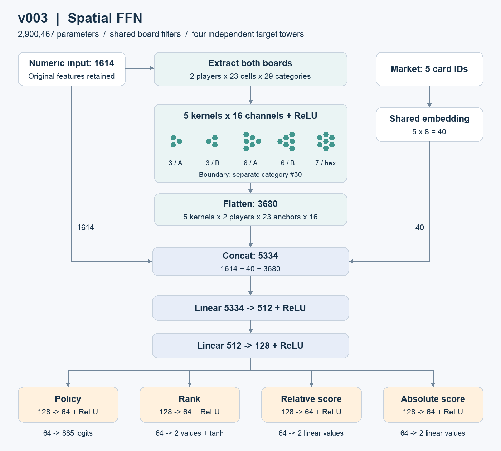
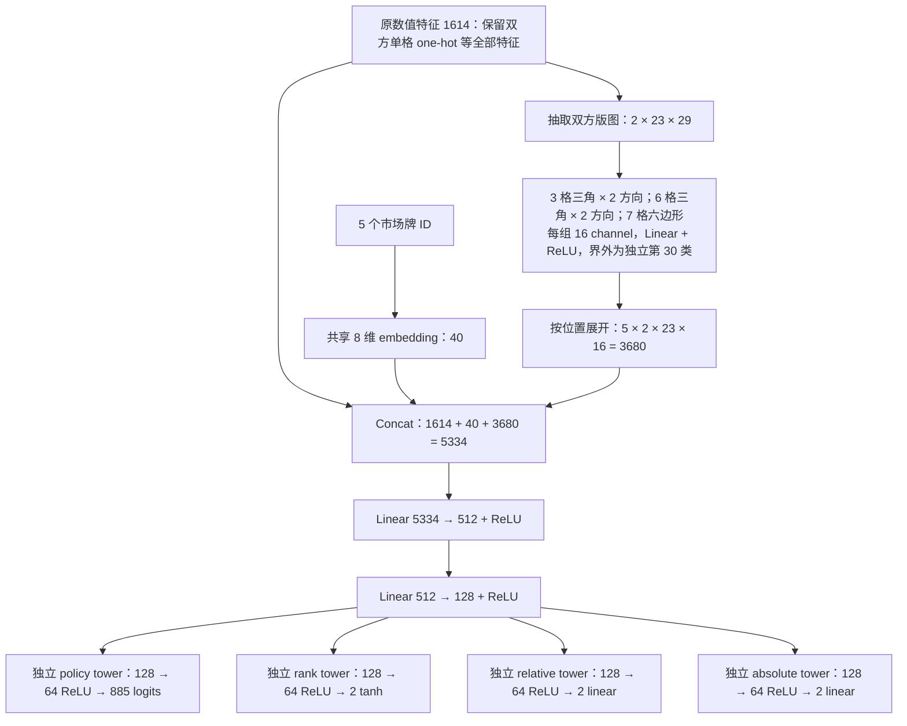

# v003 空间特征与网络扩容

2026-10-29 实现；小规模训练与 serving 测速已完成；正式10轮于2026-10-30完成并通过全量数据核验。版本记录见 [v003-spatial](../rl/experiments/10-rounds/v003-spatial/README.md)。

## 网络结构





三个 value 输出仍是 `[当前行动玩家, 对手]`；rank 取 tanh，分数 heads 保持线性、单位为 100 分。合法动作 mask、loss、优化器、MCTS 和 playout cap 策略保持原实现。

| 部分 | 参数量 |
| --- | ---: |
| 市场 embedding | 264 |
| 5 组空间 kernel | 12,080 |
| 5334 → 512 | 2,731,520 |
| 512 → 128 | 65,664 |
| 4 个 128 → 64 tower 隐层 | 33,024 |
| 4 个输出层 | 57,915 |
| 合计 | **2,900,467** |

旧模型 `1654 → 128 → 128 → heads` 共 343,555 参数，新模型为其 **8.44 倍**；约 94.2% 的参数在新的第一层 FFN。

## Hex kernel 的精确定义

在每位玩家的全部 **23 个实际棋盘格**上分别锚定 kernel，每个 kernel 都输出 23 个位置。保留伸出边界的 patch；不存在的邻格使用独立界外类别，不额外在棋盘外放锚点，不做 global pooling。每组 kernel 的权重在所有位置和双方玩家间共享；两种三角方向使用独立权重。

引擎的列偏移坐标转为轴坐标：`q = col`，`r = row - floor(col/2)`。每组 kernel 的固定偏移如下；A/B 对应源码名 `down`/`up`，是互为中心反向的两个方向（实际显示朝向取决于棋盘绘制方向）。120° 旋转后的三角形与同方向的平移等价，60° 旋转则切换两种方向。这里没有旋转增强或旋转不变性约束。

| Kernel | 相对锚点的 (q,r) 偏移 |
| --- | --- |
| 3 格三角 A | (0,0), (1,0), (0,1) |
| 3 格三角 B | (0,0), (-1,0), (0,-1) |
| 6 格三角 A | (0,0), (1,0), (2,0), (0,1), (1,1), (0,2) |
| 6 格三角 B | (0,0), (-1,0), (-2,0), (0,-1), (-1,-1), (0,-2) |
| 7 格六边形 | (0,0), (1,0), (1,-1), (0,-1), (-1,0), (-1,1), (0,1) |

每个格子的输入是 30 维：原 29 类 one-hot 后补一位 0；界外是前 29 维全 0、最后一位 1。对含 K 格的 patch 计算 `ReLU(W[16, K×30] × flatten(patch) + b[16])`，这是 hex 网格上的共享局部卷积。展开顺序固定为 `kernel → 当前玩家/对手 → 23 个锚点 → 16 channel`。

TypeScript 使用引擎坐标生成索引；[spatial.json](../rl/spatial.json) 由 `npm run rl -- spatial-schema --output rl/spatial.json` 生成，Python 读取同一份表。测试用引擎 `neighbor` 独立核对偶／奇列、两种方向和边界。TypeScript 推理仅跳过 one-hot 的零项，保留求和顺序，并与稠密卷积做逐元素一致性测试；PyTorch 保留普通可微 Linear，所有空间 kernel 都参与反向传播。

## 模型版本与使用

原始 observation、数值特征和动作编号没有变化，因此训练数据 schema 仍为 `harmonies-rl-v2`。新增的是模型架构标记 `architecture="spatial-v3"`，空间索引版本为 `harmonies-spatial-v1`。旧 `.pt` 和 JSON 模型继续按 `ffn-v2` 加载；新 checkpoint 保存架构与完整空间 schema，新 JSON 保存 5 组 filter 和 4 个 tower 的参数。未标记／缺少空间参数或维度错误会在加载时拒绝。

```bash
# 新模型默认 512 → 128；旧架构默认值仍是 128 → 128。
.venv-rl/bin/python rl/train.py init --architecture spatial-v3 --out rl/runs/spatial-example/initial

# 训练与断点续训自动从 checkpoint 恢复架构。
.venv-rl/bin/python rl/train.py train --resume rl/runs/spatial-example/initial.pt \
  --data trajectories.jsonl --epochs 1 --out rl/runs/spatial-example/trained

# 采集、serve、act、gate 等现有 CLI 可直接加载新 JSON。
npm run rl -- act --model rl/runs/spatial-example/trained.json --input observation.json --simulations 128

# 新 self-play loop 支持 --architecture spatial-v3；正式实验使用 run/source/ 中冻结入口。
.venv-rl/bin/python rl/loop.py --out rl/runs/spatial-example/loop --iterations 1 --architecture spatial-v3
```

旧 replay 可以用于新网络，因为输入语义不变；这不意味着应默认拿旧 replay 续跑正式版本。v003 的此次数据副本仅用于测速，未写入 v001/v002 的 replay 或改动其模型。

## 小规模速度对比

硬件 Apple M4，CPU 单线程，PyTorch 2.6.0，Node v24.17.0。双方分别以 seed 1729 初始化原架构和新架构，不拿训练成熟度不同的模型对比棋力。

- 训练：只读 v002 第 10 轮的前 21 局完整轨迹，取其中前 512 条 expensive 状态。双方使用完全相同的 8 个 batch（batch size 64）；预热 10 步，再计时 3 × 100 步，交替模型顺序。计时包括 forward、全部 loss、backward、梯度裁剪与 AdamW；张量预先构建，不含磁盘读取与逐参数监控日志。为稳定计时重复使用小样本，不能把这次 loss 下降当作泛化验证。
- NN 推理：来自 3 局的早／中／后期共 12 个相同公开状态；预热后每次循环 240 次，3 次重复，中位数。`predict` 包括特征编码，模型加载不计时。
- 独立 MCTS：同一批 12 个状态、每次新建树，serving 温度 0、噪声 0，新增 16／128 模拟，各重复 3 次。两模型每个根分别实际调用 NN 17／129 次，预算相同。
- 完整 serving：双方各用自己的网络自对弈 2 局（同环境种子交换顺位），每动作新增 128 模拟、回合内复用树。模型不同导致动作及局长不同，因此另报每局实际决策数。

| 指标（重复测试中位数） | 旧 FFN | v003 spatial | 新／旧耗时 |
| --- | ---: | ---: | ---: |
| 训练 step，batch 64 | 1.341 ms | 9.994 ms | 7.45× |
| 训练吞吐 | 47,721 rows/s | 6,404 rows/s | — |
| TS 单次 NN predict | 0.102 ms | 0.959 ms | 9.43× |
| MCTS 16，单状态 | 4.640 ms | 19.213 ms | 4.14× |
| MCTS 128，单状态 | 38.464 ms | 171.778 ms | 4.47× |

完整 serving 的两局平均：旧模型 **3.389 秒／局、91 个决策／局**；新模型 **15.520 秒／局、84 个决策／局**。每局时间之比约 4.58×；按动作归一化约为 37.24 对 184.76 ms／动作。两边都实际继承了搜索树访问。自对弈双方相同，交换名字后轨迹相同是预期行为，这两局只用于执行与速度验证。

运行结果表明框架可训练、可导出并可执行完整 serving；没有据此证明新模型棋力或泛化能力提高。相同 MCTS 模拟预算的耗时已明显增加，后续棋力对比应同时注明搜索预算和实际耗时。测速是小规模 CPU 跑图口径，不宜直接等同于含 SQLite、日志、采样和晋级对局的完整训练吞吐。

完整可复现数据见 [benchmark.json](../rl/experiments/10-rounds/v003-spatial/benchmark.json)，逐次计时、完整 serving 轨迹及训练前后模型在本地 [benchmark 目录](../rl/experiments/10-rounds/v003-spatial/run/benchmark-20261029)。复现需使用新的输出目录：

```bash
.venv-rl/bin/python rl/benchmark_scaling.py --out rl/runs/spatial-speed-new
```

## 验证

覆盖空间索引、界外／空格区分、双方权重共享、稀疏／稠密计算等价、PyTorch／TypeScript 输出一致性、各 kernel／tower 梯度更新、小批次 loss 下降、checkpoint 恢复、模型元数据拒绝、self-play loop 架构登记与续训，以及旧 FFN 回归测试。最终执行结果记录于版本目录的 verification.json。
